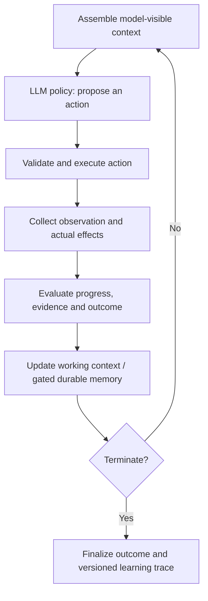

# Agent Harness Contract (AHC)

**Toward a general-purpose execution and learning interface for agentic post-training.**

*Research position paper and candidate reference-standard proposal · October 2026 · Draft v0.2*

[Read the technical paper (PDF)](./paper.pdf)

## TL;DR

An LLM agent is more than a model: it repeatedly **assembles context, chooses an action, interacts with an environment, observes the result, evaluates progress, updates state or memory, and either continues or stops**. We argue that this lifecycle can form a **general-purpose harness contract** shared by heterogeneous agentic tasks, including coding, research, web workflows, and recommendation.

**Our central proposal:** standardize the **execution and learning interface**, *not* a fixed set of eight files, a single agent SDK, or an identical implementation for every task. Such an interface can provide a reusable substrate for **agentic post-training**: models can learn from comparable, well-attributed interaction trajectories while each task retains its own tools, context, state, reward signals, and safety constraints.

The paper proposes **Agent Harness Contract (AHC)** to connect task execution with training, evaluation, and two complementary optimization pathways:

- **Optimize the LLM policy (θ):** learn better actions, planning, tool use, recovery, and stopping decisions from trajectories and task-dependent feedback.
- **Optimize the harness (φ):** improve context assembly, memory retrieval and updates, tool routing, orchestration, guardrails, and verification—without necessarily updating model weights.
- **Study their interaction:** keep both versions and evaluation conditions explicit so improvements can be attributed and training/serving mismatches detected.

> **Scope:** This is a proposed reference architecture and research agenda, **not** an adopted industry standard, a universal-agent theorem, a new RL algorithm, or a claim of experimentally validated gains.

## The common agent execution loop

This is a **shared interaction protocol**, not a claim that different tasks should use identical action spaces or rewards. A coding task can use tests and a sandbox; a browser agent may require approvals; a recommendation agent may depend on delayed, confounded user feedback. All can expose the same high-level lifecycle while retaining domain-specific semantics.

## What the paper covers

| Theme | Main question | Proposal or analysis |
| --- | --- | --- |
| **1. Universal execution** | Can diverse digital tasks be expressed by a common agent interaction loop? | Define context, action, actual execution effects, observation, evaluation, state update, and termination as explicit lifecycle responsibilities. |
| **2. Standardizable components** | Do all agents need the same eight Harness² components? | Treat prompts, memory, skills, tools, scripts, subagents, guardrails, and plugins as composable implementations; standardize interface semantics, not the component count. |
| **3. Existing frameworks and gaps** | How close are current systems? | Compare ReAct; LangGraph; OpenAI Agents SDK; Google ADK; MCP; OpenEnv; OpenTelemetry; Agent Lightning; Agent-R1; Harness²/AHE; Self-HPO/SIA, and related work. Identify gaps in cross-runtime semantics, training-trace validity, replay, and attribution. |
| **4. Agentic post-training** | What turns an execution log into valid learning data? | Track exact model-visible context, admissible actions, model/harness versions, intended vs. executed actions, state changes, reward provenance, and training eligibility. |
| **5. Context and memory** | Can long-context decisions become trainable policies? | Distinguish working context, evidence, trajectories and persistent memory; examine retrieval, compression, updates and an illustrative unified-memory design. |
| **6. Feedback and reward** | What if ground truth is noisy, missing or delayed? | Separate *done*, *correct*, and *reward*; record feedback sources, confidence, latency, exposure biases and attribution limits. |
| **7. Dual optimization** | When should we train the LLM versus improve the harness? | Formalize policy-only, harness-only and controlled alternating optimization; propose 2×2 model–harness comparisons and budget-matched evaluations. |
| **8. Reference standard feasibility** | Does standardization actually help? | Propose an Agent Harness Contract (AHC), modular conformance profiles, cross-framework adapters, and falsifiable transfer/portability experiments. |

## Where existing work fits

**The goal is interoperability, not replacement.** Existing projects solve important parts of the problem:

- **LangGraph / OpenAI Agents SDK / Google ADK:** mature agent runtimes, state, tools, orchestration, and/or observability; not necessarily a shared *cross-runtime training semantics* contract.
- **MCP / OpenEnv / OpenTelemetry:** complementary standards for tool integration, environment interaction, and telemetry; none alone specifies every field necessary for reward-attributed, replayable agent learning.
- **Agent Lightning / Agent-R1:** strong prior work on reusable agentic training infrastructure and step-level transitions, but not a universal conformance standard across arbitrary runtimes.
- **Harness² / AHE:** formalize and optimize editable harness components, primarily with fixed underlying model weights in the cited setups.
- **Self-HPO / SIA:** important prior work on joint or alternating harness–policy improvement; AHC instead emphasizes versioned, auditable comparison across frameworks and tasks.

The paper identifies open issues rather than claiming that no related framework exists.

## Proposed standardization boundary

**Standardize:** observable lifecycle semantics; typed action and effect records; context provenance; working vs. persistent state; completion vs. reward; harness/model/evaluator versioning; reusable training traces; conformance and replay tests.

**Keep task-specific:** action space, concrete prompts, skills, retrieval methods, memory layout, reward estimator, verification logic, task constraints and policy implementation.

The paper defines six optional compatibility profiles around a **Core** contract: **Memory, Training, Replay, Optimization, and Safety**.

## How to evaluate the idea

The report proposes six falsifiable studies: cross-framework portability, training usefulness of standardized traces, causal attribution of model and harness changes, long-context/memory fidelity, delayed/noisy feedback, and generalization to held-out tasks and tools. The key test is whether the added standardization produces real benefits under **matched compute and clearly defined baselines**—not whether a schema alone can make an agent smarter.

## Research status and citation

This repository currently contains **only the technical paper and its introduction**. The AHC interfaces and experiments are *proposed*; adapters and new empirical results are not included in this release. Please do not describe AHC as a ratified industry standard or cite the paper as empirical proof of cross-task transfer.

**Paper:** *Toward a Reference Standard for Agentic Post-Training: Universal Harness Execution Contracts, Context Management, and Model–Harness Co-Optimization* (Technical Report, October 2026). Authors to be confirmed before any public release.
