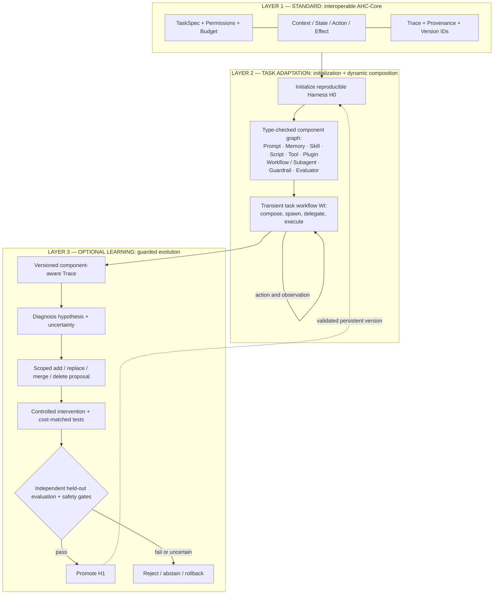
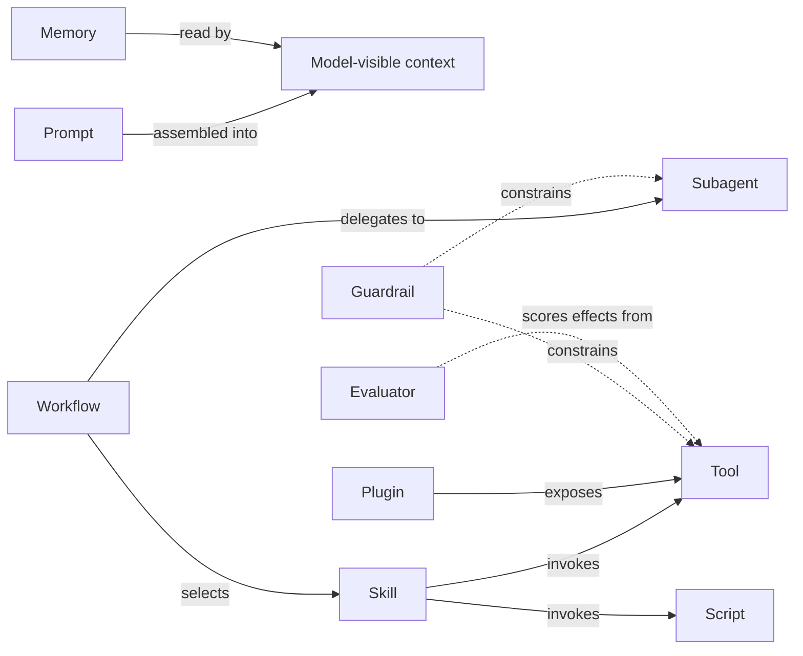
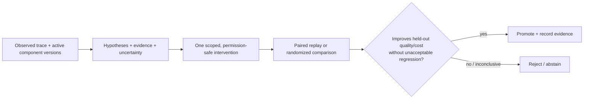

# Agent Harness: Interoperable Contracts, Dynamic Adaptation, and Verifiable Evolution

**A candidate reference standard for agent execution, task-specific composition, component-level observability, and evidence-guided improvement**

**Author:** Guangtao Wang · **Draft v6:** October 24, 2026 · **Status:** position paper / technical synthesis / falsifiable standard proposal, **not** an adopted standard or proven universal self-evolving system.

[Read the paper (PDF)](agent-harness-reference-v6.pdf)

## The goal

> **Standardize how agent harnesses are initialized, executed, observed, diagnosed, evaluated, and evolved—without standardizing how each task is solved.**

**AHC-Core is for any compatible agent, including static agents.** The **Evolution profile is optional** and cannot guarantee improvement without meaningful feedback, budget, permitted edits, and independent validation. “Any task” is a portability research hypothesis, **not** a scientific result or a promise that all tasks can be autonomously self-improved.

## Architecture: three layers, two timescales

**Two different kinds of change:** (a) `H0` is a reproducible **persistent configuration**; in-episode `Wt` can spawn task-shaped workflows with ephemeral objects. (b) durable `H1` requires an explicit **promotion** transaction, not merely a successful task-local composition. A workflow's tool permissions never exceed its parent authorization.

## Component relationships are typed, not eight disjoint buckets

A Skill may invoke a Script, a Plugin may expose tools, a Subagent is part of orchestration, and Guardrails cut across components. AHC proposes typed relationships (`contains`, `invokes`, `delegates`, `reads`, `constrains`, `evaluates`) with version compatibility, instruction precedence, scope, authorization and lifecycle metadata.

## Task-specific mappings (proposed adapters, not existing AHC implementations)

| AHC concern | **Search Agent** | **Coding Agent** | **Browser Agent** |
|---|---|---|---|
| Task | Research question / evidence constraints | Repository issue / target tests | Website workflow / user authorization |
| Prompt + Skills | Query rewrite, source verification, synthesis | Repository navigation, edit, debug | Plan, navigate, form verification |
| Tools + Scripts | Search/visit, evidence extract/dedupe | Shell, editor, grep, test runner | Click/type/DOM, screenshot, page parser |
| Memory / State | Visited sources, query history, grounded claims | Repo map, change history, failures | Page and form state, user instructions |
| Dynamic composition | Fan-out researchers, verifier subagents | Parallel isolated worktree fixes and review | Reader/actor split, approvals |
| Guardrails | Citation grounding, query budget | Sandboxing, protected files, rollback | Confirm irreversible actions and restricted sites |
| Diagnosis hypothesis | Bad retrieval vs poor query skill vs stale memory | Wrong navigation vs patch/test tool vs prompt | Stale selector vs planner vs permission issue |
| Independent evaluation | Gold answers *where available*, citation support, cost | Hidden tests, regression, cost and safety | Verified final state, side effects, time and cost |
| Example code | [Open Deep Research](https://github.com/langchain-ai/open_deep_research) (archived), [LangGraph](https://github.com/langchain-ai/langgraph) | [SWE-agent](https://github.com/SWE-agent/SWE-agent), [OpenHands](https://github.com/OpenHands/OpenHands) | [BrowserGym](https://github.com/ServiceNow/BrowserGym) |

**EAT-style search tracing:** evidence/answer states can describe *where an agent got stuck*, but cannot identify whether a prompt, tool, memory or skill *caused* it. AHC adds component provenance and controlled tests. Gold evidence used for offline benchmarking is unavailable in many deployed tasks.

## From diagnosis to **tested** attribution

Logging the active skill **does not prove** the skill caused a failure. Component effects may interact, a tool may lack necessary evidence, or the model may be the limiting factor. Attribution should explicitly separate diagnosis confidence from the measured effect of an edit; observational correlations are not causal effects.

## Fair evaluation: harness evolution versus simple search

**Mandatory comparators under matched *total* model calls, feedback/evaluator uses, tokens, execution costs and human effort:** `H0` only; parallel best-of-N; sequential task refinement; blind whole-harness or prompt editing; provenance-only diagnosis; and AHC-guided component editing. Report the full edit-search budget, not only the final deployment run.

Use a predeclared development split for search, an independent validation split for promotion, and untouched held-out test tasks for scientific claims. Evaluate success and cost jointly, human/LLM judge agreement, adverse outcomes, cross-runtime reproducibility, and unobserved failures. An improvement on the same benchmark used to select edits **does not establish generalization**.

## Self-evolution can mean removing complexity

Supported *proposed* edit types: **add · replace · rewire · merge · simplify · delete**. On a new base-model checkpoint, revalidate smaller prompts, fewer skills, less memory and simpler orchestration instead of assuming the harness should only grow. Anthropic reported removing over 80% of a system prompt on its newer model generation without a measurable loss on its coding evaluations; this is a **model/product-specific observation, not an AHC target**.

## What existing work supports — and what it does not

| Evidence | What it establishes | What it does **not** establish |
|---|---|---|
| [Anthropic dynamic workflows](https://claude.com/blog/a-harness-for-every-task-dynamic-workflows-in-claude-code) | Runtime can generate task-shaped workflows on demand | Universal, safe AHC-compatible evolution |
| [Anthropic context engineering](https://claude.com/blog/the-new-rules-of-context-engineering-for-claude-5-generation-models) | Prompt simplification may help with stronger models | That deleting prompts always helps |
| [AHE](https://arxiv.org/abs/2604.25850) · [code](https://github.com/china-qijizhifeng/agentic-harness-engineering) | Component/experience/decision observability and coding evolution | Cross-runtime AHC conformance |
| [Google Harness²](https://arxiv.org/abs/2610.14224) · [code](https://github.com/google-research/harness2) | Task-level and persistent harness recursion | A general industry standard |
| [MESH-Harness](https://arxiv.org/abs/2610.05300) | Modular bandit-guided harness composition | Proof a single schema covers every task |
| [Rethinking evaluation](https://arxiv.org/abs/2607.12227) · [code](https://github.com/rethinking-harness-evolution/code) | Cost/feedback matched search can rival harness evolution; transfer can be limited | That evolution can never work |

For runtime and telemetry baselines, see [OpenAI Agents SDK](https://github.com/openai/openai-agents-python), [Google ADK](https://github.com/google/adk-python), [LangGraph](https://github.com/langchain-ai/langgraph), [MCP](https://github.com/modelcontextprotocol/servers), [OpenTelemetry](https://github.com/open-telemetry/semantic-conventions), and [Agent Lightning](https://github.com/microsoft/agent-lightning). These are interoperability *targets or precedents*; **none is claimed to have adopted AHC**.

## Research roadmap and falsification gates

1. Publish machine-readable AHC-Core event fixtures, manifest compatibility rules and privacy-safe examples.
2. Implement **two independently engineered runtime adapters**, one Search and one Coding; pass action/effect/permission/rollback conformance tests.
3. Measure provenance completeness and attribution reliability against full-trace LLM diagnosis and heuristic/evidence-only baselines.
4. Test **targeted single-component edits** against blind edits, parallel sampling and sequential refinement at matched total budgets.
5. Introduce dynamic workflow composition with sandboxed delegation and explicit transient-versus-persistent version boundaries.
6. Test add/replace against simplify/delete edits across a base-model update; disclose regressions.
7. Add Browser or another qualitatively different task; require held-out generalization, safety checks and independent evaluation before calling it cross-task evidence.

**Falsifiable bottom line:** AHC can be a valuable interoperability contract without having an Evolution profile at all. If independent runtimes cannot pass conformance, it fails as a standard proposal. If targeted edits fail to outperform equal-budget simple search on holdout, its autonomous-improvement hypothesis fails in those settings. No new AHC implementation experiments are claimed in this repository.

## Build and status

LaTeX: `pdflatex main.tex && biber main && pdflatex main.tex && pdflatex main.tex`. The source is split into topic files including `architecture_extension.tex`, `attribution_extension.tex`, `evaluation_extension.tex`, and `landscape_extension.tex`.
